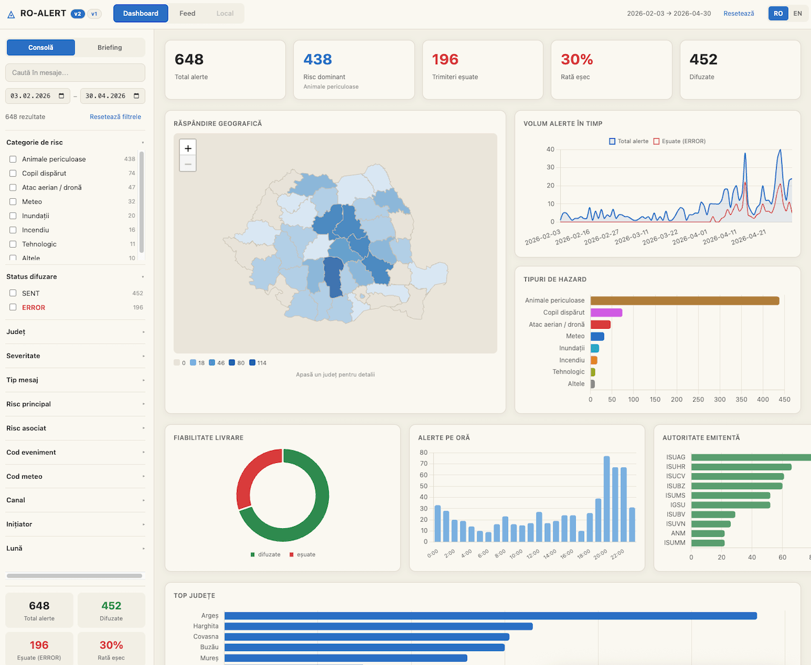

# RO-ALERT Dashboard

&rarr; [lab.gov2.ro/ro-alert](https://lab.gov2.ro/ro-alert/) – _POC (Proof of Concept)_

---

Sursă date: [data.gov.ro / IGSU](https://data.gov.ro/ro/dataset?q=mesaje+ro-alert&organization=inspectoratul-general-pentru-situatii-de-urgenta)

Vezi și: [RO-ALERT, februarie–iulie 2026](https://mariuscomper.uk/ro-alert/) — analiza lui Marius Comper pe aceleași date IGSU.

## Deploy

`tools/deploy.sh` copies the files that the page loads (`index.html`, `css/`, `js/`, `vendor/`
and the three data bundles) to a folder on this machine or on a host over SSH.

1. Copy `.env.example` to `.env` and set `DEPLOY_PATH`. Set `DEPLOY_HOST` for a remote host.
2. Run `tools/deploy.sh --dry-run` and read the file list.
3. Run `tools/deploy.sh`.

Use a second file for another target, for example `tools/deploy.sh --env .env.vps`.
The script refuses to copy when a deployed file has uncommitted changes.
`DEPLOY_DELETE=1` removes stale files inside `css/`, `js/` and `vendor/` only.
A remote host needs `rsync` and SSH access.

## Tests

The tests need no network. Run them from the repository root.

- Python: `.venv/bin/python -m unittest discover -s tests -p 'test_*.py'`. The ingest tests need `xlrd` and
  `openpyxl` (`python3 -m venv .venv && .venv/bin/pip install -r requirements.txt`) and skip without them. The fixture generator
  `tests/fixtures/make_fixtures.py` also needs `xlwt`. Run it only to change fixtures; CI uses the committed files.
- JavaScript without a browser (Node 20 or later): `node --test tests/js/*.test.cjs`
- Time zone check: `TZ=UTC node --test tests/js/*.test.cjs`, then the same command with
  `TZ=Europe/Bucharest` and `TZ=America/New_York`.
- Browser smoke test from `file://` (development only): run `npm install` once. It installs
  `playwright-core` and downloads no browser. Then run `node tests/browser/smoke.cjs`. The test
  uses the installed Google Chrome. Set `CHROME_PATH` when Chrome is in another place. Set
  `SHOTS=/some/folder` to save screenshots. The state, place, link and language checks (audit 03)
  live in `tests/browser/state.cjs`; `smoke.cjs` runs them. The phone, keyboard, dialog, chart-table,
  contrast and reduced-motion checks (audit 04) live in `tests/browser/access.cjs`. They also run an
  `axe-core` scan (development dependency, installed by `npm install`). The pages, export, rendering
  lifecycle and load-error checks (audit 06) live in `tests/browser/browsing.cjs`. The load-error checks
  copy the page to a temporary folder and, for the JSON fallback, serve it on `127.0.0.1`. The full run
  takes about 12 minutes.
- Render measurement: `node tests/browser/measure.cjs` prints the DOM size and the time from a state
  change to the next painted frame for the same selections on any commit. It prints the browser,
  the machine and the CPU throttle (`CPU_THROTTLE=4` slows the CPU; `RUNS=7` sets the sample size).
  The times depend on the machine, so compare runs from one machine only.

### Ingest workflow

- `python ingest.py` stages every download, checks it, then commits `sources/` through a journal
  (`sources/.ingest-txn`). An interrupted run is recovered at the start of the next run.
  Exit code 0 means success or no change. Exit code 1 means a rejected file.
- `--refresh` downloads again and compares content, even when `last_modified` is equal.
  `--result PATH` writes the outcome as JSON.
- When two resources describe one month with different bytes, ingest stops. Choose one resource
  in `sources/resource_choices.json` (month -> resource id).
- `.github/workflows/ci.yml` runs the offline tests and checks that a rebuild equals the tracked bundles.

`python3 tools/risk_change_report.py OLD_ALERTS_JSON` compares two builds by alert ID and writes
`data/risk_changes.csv` (ignored by Git).

`python3 tools/field_diff.py --dump OLD.json` writes the full alerts of the current inputs. Run it on
the old commit, then `python3 tools/field_diff.py OLD.json --allow FIELD,FIELD` on the new one. The tool
lists every changed field with its alert count and exits 1 on any field outside `--allow`, on a changed
ID set, or on a changed delivery row.

### Link format

The page keeps its state in the URL hash: `#schema=1&view=feed&lang=en&f.risk_category=Meteo&from=2026-04-01`.
Keys: `schema`, `view`, `lang`, `q`, `from`, `to`, `f.FIELD` (repeated), `county`, `place` (SIRUTA code),
`record`, `sort`, `dir`, `page`. A key appears only when it is set or differs from its default; a default
state has an empty hash. `js/urlstate.js` reads and writes the hash. `page` applies to the Table, Feed and
Local lists (50 records per page). A page past the end shows the last page, and the URL reports it.

### Export

Table and Feed have an Export selection button. It downloads one UTF-8 JSON file with the whole
selection, not only the visible page. The file holds `schema_version`, `exported_at`, `selection`
(filters, scope, language, sort), `sources` (the months of the selected records), `attribution`,
`coverage` and `records` (normalized alerts with their deliveries and original text). CSV is not offered.
